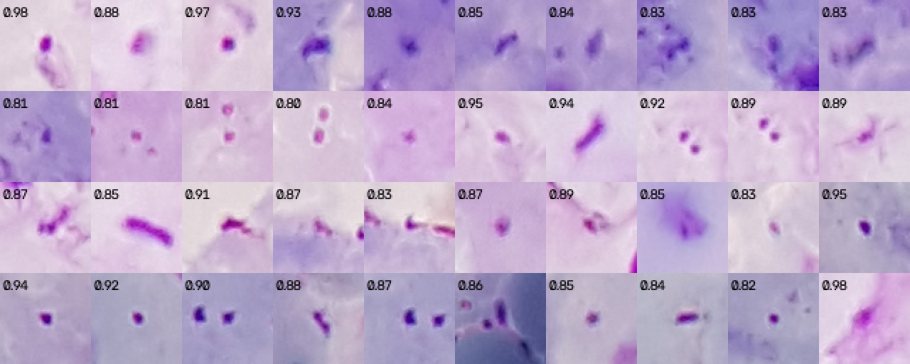
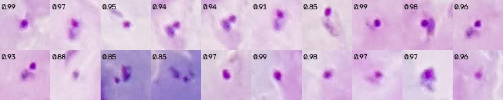

# Parasite detection: what was measured, in the order it happened

Branch `u/parasite-detector`, 26 and 27 August 2026. Every number here is
reproducible from `eval/`; the held-out ones use the same 50 patients the white
cell work never fitted on (`eval/results/wbc_sweep.json`, `fit_patients`).

## 1. The annotation was being read wrong, by 13 px

Before any detector: overlaying the parasite annotations on the pixels showed
the circle sitting consistently to one side of the chromatin dot. The `Circle`
shape stores two points, and we had read them as a drag across the parasite,
taking the midpoint as the centre. They are the **centre and a point on the
rim**.

Measured on 834 parasites in 25 fit images, distance from the most purple pixel
near the annotation to:

| reading | median | within 8 px |
|---|---|---|
| midpoint of the two points (old) | 12.8 px | 22% |
| **first point (centre)** | **7.9 px** | **51%** |
| second point | 22.7 px | 1% |

On a 10 px object, 13 px off is a miss. Fixed in `annotations.py`, pinned by
`test_parasite_centre_is_the_first_point_not_the_midpoint`. The white cell
results are unaffected: their tolerance was 55 px and they are `Point`s.

Two consequences. The annotator's radius (median 21 px) is a loose circle, not
the size of the dot, so it is only an upper bound. And the residual 8 px at the
median is annotation imprecision we cannot remove, so the matching tolerance
for scoring is 15 px, not the 12 we started with.

## 2. Candidate recall is the ceiling, and a threshold could not reach it

First candidate generator: threshold the stain map (`a - b` in Lab), connected
components, area gate. **Candidate recall 52%.** No classifier can find a
parasite that never became a candidate, so this was diagnosed before anything
else:

| why a parasite was missed | share |
|---|---|
| inside a blob larger than the area gate | 35% |
| near a white cell (exclusion zone) | 4% |
| candidate exists but 12 to 30 px away | 10% |
| no blob at all | 3% |

The missed parasites were not faint. Their stain was stronger than the found
ones (median 86 against 77). Where the field itself is heavily stained, a
global threshold merges everything into one region and the area gate drops
it.

Second generator: morphological **top-hat** on the stain map (stain minus its
opening with a 31 px disc, bigger than any parasite) removes the background,
and a parasite is a **local maximum** of what remains. Two parasites that touch
are two peaks.

| | threshold + components | top-hat peaks |
|---|---|---|
| candidate recall (100 fit images) | 52% | **88%** |
| candidates per image | 300 | 422 |
| true parasites among them | | 9.4% |

The remaining 10 to 12%, opened on 10 fit images (584 parasites):

| why | share |
|---|---|
| inside the white cell exclusion zone | 3.6% |
| outside the 0.96 disc inset or the feature margin | 3.3% |
| a candidate exists, 15 to 25 px away | 2.6% |
| no local maximum of its own | 0.2% |
| top-hat below `PEAK_MIN` | 0% |

Nothing is lost to the peak threshold. The rim loss is by design (the eyepiece
edge is dim and smeared; the white cell count skips it too, so the ratio is
consistent). The exclusion zone is the one worth a look later: some of those
are parasites next to a nucleus, some may be parasite clusters that the
quarter-scale nucleus mask mistakes for a small white cell.

## 3. The look-alikes

Measured on the fit images after stain normalisation (Lab, median):

| | L | a | b | a - b |
|---|---|---|---|---|
| parasite centre | 163 | 155 | 101 | 54 |
| field | 200 | 137 | 117 | 20 |
| unannotated purple blob | 165 | 151 | 104 | 46 |

The third row is the problem. Platelets, stain precipitate and fragments of
lysed cells are the same colour and nearly the same size as a parasite. The
candidate step finds them all; the classifier has to tell them apart, and
colour alone cannot.

## 4. Classifier A: nineteen features and a small network

Per candidate: peak height, stain and lightness in a 4 px core, the same in an
8 to 16 px ring, contrast against the local field, size at half peak,
elongation, solidity, distance to the nearest white cell, number of other
peaks within 20 px. A 19 -> 64 -> 32 -> 1 network, trained in numpy, written
as ONNX, run by `cv.dnn`. OpenCV 5 has no `ml` module, so this is how a
classifier stays inside OpenCV at run time.

Cross-validated **by patient** on the fit set (candidate level), 5 folds:

| threshold | precision | recall | F1 | count bias |
|---|---|---|---|---|
| 0.60 | 0.568 | 0.759 | 0.650 | +33% |
| 0.70 | 0.624 | 0.693 | 0.657 | +11% |
| 0.75 | 0.657 | 0.653 | 0.655 | -0.6% |

Folds ranged from 0.57 to 0.72: patient-to-patient variation is large.

**End to end on the 50 held-out patients** (99 images, 4731 parasites,
threshold 0.7, `eval/results/parasite_eval_holdout_mlp.json`):

| | value |
|---|---|
| precision | 0.656 |
| recall | 0.643 |
| F1 | 0.650 |
| count bias | -0.94 per image (**-2.0%**) |
| count MAE | 20.3 per image |
| parasites per white cell, bias vs truth | +17.4% |
| rank correlation of the ratio | 0.858 |

The count bias is small because false alarms and misses roughly cancel, which
is exactly the situation `parasite_eval.py` was written to expose: the MAE of
20 per image says the per-image number is not trustworthy yet. The ratio
bias (+17%) is larger than the count bias because the white cell count sits
under it and its own +2.5% bias compounds, and because images with few
parasites make the log ratio noisy.

This is the baseline. It is kept as `--model mlp` for the ablation.

## 5. Classifier B: a patch network

The same candidates, but instead of nineteen numbers the classifier sees the
32 x 32 BGR patch around the peak (cut at 40 x 40, randomly cropped, flipped
and turned during training). Three conv blocks (24, 48, 96 channels) to 4 x 4,
then a 96-wide head. Trained with torch in its own venv (`make setup-train`,
because the last torch wheel for this Mac needs NumPy 1), exported to ONNX,
checked against `cv.dnn` to 2.4e-7, and run by `cv.dnn` like the MLP. Pixel
normalisation is inside the graph.

Cross-validated **by patient**, 5 folds, 10 epochs, 42 237 patches from 100
fit images (candidate level):

| threshold | precision | recall | F1 | count bias |
|---|---|---|---|---|
| 0.60 | 0.593 | 0.857 | 0.701 | +45% |
| 0.70 | 0.648 | 0.790 | 0.712 | +22% |
| 0.75 | 0.682 | 0.747 | **0.713** | +9.5% |
| 0.80 | 0.723 | 0.688 | 0.705 | -4.8% |

Against the feature MLP at its best threshold (0.657), that is +5.6 F1 points,
and the bias crosses zero near 0.78, which is the threshold used end to end.
Folds still spread from 0.64 to 0.74: the patient is the unit of variation,
and 100 images is one image per patient.

End to end on the 50 held-out patients: see section 6.

## 6. End to end on the held-out patients

Same 50 patients, 99 images, 4731 annotated parasites, nobody fitted anything
on them. The threshold is the one chosen on the fit set (section 5), not
re-chosen here.

| | feature MLP (thr 0.70) | patch CNN (thr 0.78) |
|---|---|---|
| precision | 0.656 | **0.827** |
| recall | 0.643 | 0.655 |
| F1 | 0.650 | **0.732** |
| count bias | -2.0% | **-20.8%** |
| count MAE per image | 20.3 | 13.4 |
| parasites per white cell, bias | +17.4% | -16.5% |
| rank correlation of the ratio | 0.858 | **0.908** |

Two readings of the same table.

The patch network finds parasites more reliably: better precision by 17
points, better per-image error, better ranking of patients by density. That
is the number a screening tool needs, since the first job is to sort patients.

But it **under-counts by a fifth** at this threshold, where the cross-validated
bias on the fit set was near zero. The first guess was crowding, and it was
wrong. Split by how many parasites the image holds:

| parasites in truth | images | recall | precision | count bias |
|---|---|---|---|---|
| 0 to 9 | 33 | 0.588 | 0.495 | +18.7% |
| 10 to 29 | 28 | 0.572 | 0.691 | -17.3% |
| 30 to 79 | 17 | 0.554 | 0.771 | -28.1% |
| 80 and more | 21 | 0.697 | 0.889 | -21.6% |

Recall is flat to slightly *better* on dense fields. What changes with density
is precision: on a nearly clean field half of what the network calls a
parasite is not one, and on a heavy field nine in ten are. The under-count
comes from a threshold that is too high everywhere (recall 0.55 to 0.70
against a candidate ceiling of 0.88), and the dense images hold most of the
parasites so they dominate the total. The over-count on sparse fields is the
harder problem: a screening tool must not invent parasites on a negative
slide. The MLP's -2% is not better calibration, it is false alarms and misses
cancelling, as its MAE of 20 shows.

The threshold sensitivity on the held-out set, recorded for information only.
It is not used to pick the threshold, because choosing on the held-out set
would make it a fit set:

| threshold | precision | recall | F1 | count bias |
|---|---|---|---|---|
| 0.60 | 0.680 | 0.773 | 0.724 | +13.7% |
| 0.65 | 0.722 | 0.752 | 0.737 | +4.2% |
| 0.70 | 0.764 | 0.725 | 0.744 | -5.2% |
| 0.75 | 0.804 | 0.684 | 0.739 | -14.9% |
| 0.80 | 0.847 | 0.631 | 0.724 | -25.5% |

So the network itself is fine across a wide band (F1 0.72 to 0.74 from 0.60
to 0.80); what moved between fit and held-out is where the bias crosses zero,
from about 0.78 to about 0.67. One image per patient is too few to calibrate a
threshold on, which is the first reason to train on more.

## 7. Three images per patient instead of one

Same network, same recipe, 128 432 patches from 298 fit images (3 per
patient), 3 folds by patient, 8 epochs. Threshold 0.80, the fit-set grid
point nearest zero bias (+4.1%).

Cross-validated F1 did not move: 0.712 at 0.75, against 0.713 before. The
held-out numbers did:

| | 1 image / patient | **3 images / patient** |
|---|---|---|
| precision | 0.827 | 0.823 |
| recall | 0.655 | **0.705** |
| F1 | 0.732 | **0.759** |
| count bias | -20.8% | **-14.4%** |
| count MAE per image | 13.4 | **10.9** |
| parasites per white cell, bias | -16.5% | **-7.9%** |
| rank correlation of the ratio | 0.908 | **0.930** |

Sensitivity on held-out (information only): F1 peaks at 0.763 at 0.75 and the
bias crosses zero near 0.72, so the fit-set threshold is still a little high
for these patients, but by less than before (0.78 against 0.67 last time).

By parasite density:

| parasites in truth | images | recall | precision | count bias |
|---|---|---|---|---|
| 0 to 9 | 33 | 0.676 | 0.542 | +24.7% |
| 10 to 29 | 28 | 0.618 | 0.675 | -8.4% |
| 30 to 79 | 17 | 0.604 | 0.776 | -22.1% |
| 80 and more | 21 | 0.744 | 0.880 | -15.5% |

This is the model shipped as `models/parasite_cnn.onnx`. The one-image model
is in git history (commit 217fbed) for the ablation.

What comes next: the false alarms on sparse fields, which is where a negative
slide would be called positive. The candidate features that describe context
(neighbours within 20 px, distance to the nearest white cell, local field
level) are not visible in a 32 px patch, so the next experiment feeds them to
the network alongside the patch (`--hybrid`).

## 8. The hybrid model: a negative result

Same patch network, with the 19 candidate features (neighbours within 20 px,
distance to the nearest white cell, local field level, ring statistics)
concatenated to the conv embedding before the head. Trained on the one image
per patient set so it compares with the first patch network.

| | patch CNN (1 img/patient) | hybrid (1 img/patient) |
|---|---|---|
| cross-validated F1, best threshold | 0.713 | 0.717 |
| held-out F1 | 0.732 | **0.707** |
| held-out precision | 0.827 | 0.771 |
| precision on fields with < 10 parasites | 0.495 | 0.495 |
| precision on fields with 30 to 79 | 0.771 | 0.543 |

Cross-validation said "no difference"; the held-out set said "worse". The
features that describe context also describe the patient (how crowded the
slide is, how stained), and a network that reads them learns the fit patients
rather than the parasite. The sparse-field precision, the thing this was built
for, did not move at all.

Kept as `--model hybrid` for the record, not shipped. The 3-image training of
it was stopped after the held-out result came in.

Lesson, same as the stain normalisation one in reverse: the cross-validated
candidate-level score is not sensitive enough to rank models that are within a
point of each other. The held-out, end-to-end number is the one to decide on,
and it costs ten minutes.

## 9. What the sparse-field false alarms actually are

Before building anything else for the sparse-field precision, we looked. On
26 fit images with fewer than 10 annotated parasites, the shipped network at
threshold 0.80 made 66 true and 98 false detections. The 40 highest-scoring
false ones, 64 px around each, with the score:

and true positives from the same images for comparison:

Three groups in the false ones.

**Objects that look exactly like the true positives.** A compact dark dot with
a faint halo, scored 0.9 and above (top left, bottom row). We cannot tell
them from parasites, and we suspect the annotators did not mark every parasite
on fields where there were few. If so, the measured precision on sparse
fields is a **lower bound**, and the "over-count" on negative-looking fields
is partly the ground truth's under-count. This cannot be settled without a
microscopist; it goes in the report as a caveat, stated exactly like this.

**Rods and streaks.** Elongated purple marks, several times longer than wide
(third row). These are debris and stain artefacts, and a parasite is never
that shape. The network scores them 0.83 to 0.91, so it has not learned the
shape from 32 px patches with 10 epochs. This group is recoverable.

**Diffuse blobs and doubles.** Soft purple smudges without a dense core, and
pairs of small dots (platelets often come in twos). Harder; some may be
parasites out of focus.

So the honest position on sparse fields: part of the gap is not ours to close,
part of it is shape, and shape is what a longer-trained or slightly larger
patch network should get. That is the next experiment, and it is cheap
because it needs no new data.

## 10. Twenty epochs instead of eight

Same network and data as section 7. Because three-fold training at 20 epochs
would take eight hours, the trainer got a validation-split mode
(`--val-patients 20`): 20 fit patients held aside for the threshold table,
one training on the other 80, and that model is the one exported. On the
validation patients the bias crossed zero at 0.80 (-1.8%), so 0.80 it is.

Held-out, same 50 patients:

| | 8 epochs (section 7) | **20 epochs** |
|---|---|---|
| precision | 0.823 | **0.841** |
| recall | 0.705 | 0.698 |
| F1 | 0.759 | **0.762** |
| count bias | -14.4% | -17.0% |
| count MAE per image | 10.9 | 11.1 |
| rank correlation of the ratio | 0.930 | **0.935** |
| precision, fields with < 10 parasites | 0.542 | **0.575** |
| precision, fields with 30 to 79 | 0.776 | **0.800** |

Small, consistent, and in the direction section 9 predicted: longer training
buys precision (the rod-and-streak group), at a slight cost in recall. The
two criteria set before the run, better F1 and better sparse-field precision,
are both met, so this is the shipped `models/parasite_cnn.onnx`. The 8-epoch
model stays in git history (commit 189e64f).

The calibration gap has not closed: zero bias sits at 0.80 on the validation
patients and near 0.72 on the held-out ones (F1 0.754 there, bias +3.6%).
That is a property of the patients, not of the epochs. The honest way to
report the count is with this gap stated, and the practical way to narrow it
is a threshold set per slide from the white cell density rather than one
global number. That is a later experiment.

## 11. The threshold was calibrated against the wrong reference

The plan was a per-slide threshold, since one cut-off clearly did not suit both
a nearly clean field and a heavy one. Measuring it first turned the task into a
different, simpler one.

### Where the bias comes from

On the twenty fit patients the shipped network never trained on (it kept them
back for its own threshold table, so its scores there are honest), the -12%
count bias splits in two:

| | |
|---|---|
| summed calibrated scores vs candidates that really are parasites | **-0.4%** |
| those candidates vs every annotated parasite | **-11.4%** |

The scoring is right. The candidate step loses the parasites, and no
threshold can find an object that never became a candidate.

### How 0.80 came to be wrong

The threshold table printed during training scores the classifier against **the
candidates it was trained on**. A parasite that never became a candidate is
absent from both sides of that ratio, so the bias it reports is not the bias a
user sees:

| threshold | count | bias vs candidates | bias vs every annotated parasite |
|---|---|---|---|
| 0.70 | 6 602 | +27.2% | +12.8% |
| **0.75** | 5 878 | +13.3% | **+0.4%** |
| 0.78 | 5 443 | +4.9% | -7.0% |
| **0.80** | 5 138 | **-1.0%** | **-12.2%** |

0.80 looked unbiased and under-counted by 12%. It is a wrong-denominator
mistake, and it is worth a sentence in the report because it is the kind of
error that survives review: every number on the row is real, and the column is
the wrong one.

`prf()` in `eval/parasite_cnn_train.py` now takes the measured candidate recall
and reports the bias against every annotated parasite, so the next threshold
cannot be chosen this way.

### Four methods, held-out, 609 images and 50 slides

Nothing here is fitted on these patients: the calibration and the threshold
both come from the twenty calibration patients.

| method | count bias | count MAE | slide density bias | mean abs. density error |
|---|---|---|---|---|
| fixed 0.80, what shipped | -14.4% | 10.26 | -15.3% | 48.6% |
| expected count (sum of calibrated scores) | -15.4% | 12.98 | -4.3% | 54.4% |
| expected count / candidate recall | -4.6% | 11.31 | +8.0% | 53.4% |
| per-slide threshold from a lookup | -7.3% | 9.65 | -6.7% | 44.0% |
| **fixed 0.75, chosen on the calibration patients** | **-2.1%** | **9.83** | **-1.5%** | **43.9%** |

**The per-slide threshold is not needed, and the honest reason is that it never
worked.** The lookup it fitted returned 0.74 to 0.78 for every kind of slide,
so it was a global threshold wearing a costume, and its whole gain came from
being lower than 0.80. The best threshold per calibration slide does vary a
lot, from 0.60 to 0.86, but it correlates with the provisional parasite
density at **-0.010**: there is nothing observable to look it up by. Fitting a
table on that would have been fitting noise, and it would have looked like it
worked, because lowering the threshold helps for an unrelated reason.

The scores are also **already calibrated**, which was worth checking rather
than assuming: candidates scoring 0.50 to 0.80 are parasites 30.6% of the time
and the fitted map says 31.4%. So summing probabilities adds nothing over a
threshold here, and dividing by the candidate recall fixes the count total but
widens the per-slide error, because recall varies from slide to slide much
more than the count does.

### What shipped

`parasites.DEFAULT_THRESHOLD = 0.75`, and the pipeline default follows it.
Held-out, against 0.80: count bias -14.4% to **-2.1%**, slide density bias
-15.3% to **-1.5%**, mean absolute density error 48.6% to **43.9%**.

Scored the same way as section 10 (99 images, 2 per patient), the detector at
0.75 reads: precision 0.790, recall 0.739, **F1 0.763**, count bias -6.4%,
MAE 9.96 per image. Against 0.80 the F1 is unchanged (0.762) and the trade has
simply moved along the same curve, 5 points of precision for 4 of recall, but
the count is no longer systematically low. On the full 609-image table the bias
is -2.0%.

The remaining ten points of candidate loss are the next piece of work, and this
measurement is what says so.

## 12. The stain statistics were wrong; fixed, retrained, re-thresholded

3 September 2026. `results-stain.md` has the bug: the Lab statistics behind
the normalisation were accumulated in float32 over 15 million pixels and were
off by up to 6.5 units, differently on every image. Every number above was
measured on images normalised with that error, and the patch network was
trained on them. So the whole chain was redone, in order, with nothing
touched by hand in between (`eval/results/chain_2026-09-02.log`):

1. white cell parameters refit with the stain threshold in the grid
   (`results-wbc.md`: held-out F1 0.793 to 0.851);
2. the patch network retrained with the same recipe on correctly normalised
   patches (131 456 patches, 10 840 parasites, 3 images per patient,
   20 epochs, 20 validation patients). On the validation patients the count
   bias crosses zero at 0.75 with F1 0.712, where the old network read 0.693
   and crossed zero at 0.80. `cv.dnn` reproduces torch to 3.6e-7;
3. every candidate rescored, and the threshold re-chosen on the 20
   calibration patients by the section 11 rule, count against every
   annotated parasite: **0.76** (+0.1%). Candidate recall there is 0.898,
   up from 0.886, because the refit white cell mask excludes less.

Held-out, the same 50 patients, 99 images, 4 731 annotated parasites:

| | August (0.75) | **3 September (0.76)** |
|---|---|---|
| precision | 0.790 | **0.799** |
| recall | 0.739 | **0.768** |
| F1 | 0.763 | **0.784** |
| count bias per image | -6.4% | **-3.9%** |
| count MAE per image | 9.96 | **8.09** |
| rank correlation of the parasite/white cell ratio | 0.935 | **0.947** |
| ratio bias / 95% limits (97 images) | | +4.0% / -63% to +191% |

On the full 609-image table, the four methods of section 11 at the new
threshold:

| method | count bias | count MAE | slide density bias | mean abs. density error | 95% limits |
|---|---|---|---|---|---|
| **fixed 0.76, shipped** | **-0.6%** | **9.05** | +2.3% | **43.3%** | -56% to +137% |
| expected count | -11.8% | 12.16 | +3.2% | 52.2% | |
| expected / candidate recall | -1.8% | 10.89 | +14.9% | 54.1% | |
| per-slide threshold | -5.7% | 8.98 | -4.8% | 44.3% | |

Two points of F1 and three of recall from a bug fix, with the network,
the candidate stage and the recipe unchanged. And the number that matters
did not move: **mean absolute density error per slide is 43.3%, from
43.9%.** The average count is right (-0.6%) and the spread between slides
is not. Through the WHO protocol with the real counter, 54% of slides land
within 25% of the expert density and 78% within 50%; the worst six are all
over-counts:

| slide | expert density | our error |
|---|---|---|
| TF82_15_1_9 | 14 744/µL | +200% |
| TF81_W8B5 | 1 373/µL | +142% |
| TF70_Scr440 | 3 552/µL | +122% |
| TF107_249 | 1 707/µL | +120% |
| TF48_UW31 | 43 586/µL | +87% |
| TF37_Sc563 | 4 500/µL | +80% |

That is the sparse-field false alarm problem of section 9 again, and it is
the same thing that makes clean slides read positive (`results-negatives.md`).
Those six slides are the next thing to open, one by one, before any more
modelling.

Per field, the pipeline now takes 1.34 s on the laptop against 2.65 s in
August (`bench/field_profile.py`): the stain normalisation went from 1.5 s to
0.08 s and the candidate stage stopped computing nineteen features the
network never read.

## 13. The six worst slides, opened one by one

3 September 2026, `eval/parasite_fp_look.py`, diagnosis on held-out slides
(looked at, nothing fitted on them). The six slides of section 12 split
into two different failures.

**Two are not parasite errors.** TF82 (+200%) and TF48 (+87%) *under*-count
parasites (254 found for 446, 836 for 1 106). Their density is wrong
because the denominator collapsed: the white cell detector found 19% and
40% of the annotated nuclei. Both are pink, overstained slides (raw Lab
mean *a* 158 to 164 against 135 to 151 elsewhere) where the nucleus
`a - b` after normalisation sits at 44 to 46, under the gate of 60, while
on a normal slide it sits at 95 to 118. Across the 50 held-out patients
five slides have a white cell count under 80% of the annotation and three
over 140%: a tenth of slides get a bad denominator, which is a large part
of the 43% density spread. The fix is in `results-wbc.md`: a nucleus is
also dark, and darkness survives the overstain.

**Four are false alarms on sparse slides.** TF70 (99 annotated, 361 found,
315 false), TF37 (135 / 299 / 207), TF107 (51 / 116 / 76), TF81
(40 / 108 / 80). The montage (`docs/figures/fp-look-worst4-false.png`)
shows what passes at 0.76: elongated purple rods, round solid platelets,
clumps of precipitate, a few dark blue fragments. The true positives next
to them (`fp-look-worst4-true.png`) all have the ring structure, a
chromatin dot with a cytoplasm crescent. The arithmetic behind the
over-count is simple and slide-independent: **about 3 of every 100
candidates pass the classifier as false positives** (2.8 to 3.9 per 100
across the candidate-count bands), and a field carries 300 to 800
candidates. That is 10 to 25 false parasites per field, invisible on a
field with 80 real ones and a disaster on a field with five. Rank
correlation of false positives per field with the true count is +0.67,
with candidates +0.38, with debris or focus about zero: it is not a
quality-gate problem.

On clean fields (`fp-look-clean-false.png`) the false alarms are almost
all platelets, at 0.8 to 0.98. The training set has never contained a
clean field: every negative the network saw came from an infected image,
where a platelet next to a parasite is rare and a platelet on its own is
the whole population. So the fit half of the uninfected set now supplies
negative patches (`parasite_patches.py --uninfected-images`), and the
other half stays frozen for the specificity number. Chain 2 measures both
fixes; its numbers follow in section 14.

## 14. Clean fields in the training set: the number that matters moves

4 September 2026, chain 2 (`eval/results/chain2_2026-09-03.log`): white
cells refit with the dark-nucleus rule (`results-wbc.md`), then the patch
network retrained with the same recipe plus 75 clean fields from the fit
half of the uninfected set (171 951 patches, 11 067 parasites, 40 000 of the
negatives from clean fields), candidates rescored, threshold re-chosen on
the calibration patients: **0.80** (-1.0%), candidate recall there 0.913.

Held-out, 50 patients:

| | 3 Sept (0.76) | **4 Sept (0.80)** |
|---|---|---|
| precision / recall / F1, 99 images | 0.799 / 0.768 / 0.784 | 0.802 / 0.759 / 0.780 |
| count MAE per image | 8.09 | 8.11 |
| rank correlation of the ratio | 0.947 | 0.948 |
| ratio 95% limits, 99 images | -63% to +191% | -61% to **+133%** |
| **609 images**: count bias / MAE | -0.6% / 9.05 | -1.6% / **8.80** |
| slide density bias | +2.3% | -4.1% |
| **mean abs. density error per slide** | 43.3% | **38.0%** |
| 95% limits of agreement | -56% to +137% | -55% to **+103%** |

Object-level F1 is flat; the clinical numbers move. Five points off the
per-slide density spread and the upper limit of agreement down from +137%
to +103%, because the slides that over-counted now over-count less. On
clean slides the effect is larger still, and it is the reason this was
done: see `results-negatives.md`.

Through the agent loop (`results-agent.md`), the density error with the
real counter is 38.3% against 43.5% yesterday, and the agent's decisions are
unchanged (491 fields against 490).

## 15. Chain 3: hard negatives from every fit image, 48 px patches, and a threshold chosen on patients the network never saw

6 September 2026, chain 3 (`eval/chain.sh`, `eval/results/chain3_2026-09-05.log`).
Same candidate stage, same network architecture, three changes to what it
is trained on and one bug fixed:

- **every image of every fit patient** (1 247 instead of 280) and **every
  clean field of the fit half** (569 instead of 75), mined rather than
  taken whole: every positive, every negative the chain-2 network scored at
  0.2 or above, and 10% of the rest. Nine in ten candidates were easy
  negatives the network already scored near zero, and the failures of
  section 13 were the 3% it scored above 0.2 on clean and sparse fields.
  200 868 patches, 47 573 parasites; 177 433 for training (26% positive),
  23 435 from the 20 calibration patients for validation
  (`parasite_patches.py --mine`, 25 min);
- **48 px input cut at 56** instead of 32 cut at 40: the rods and platelet
  pairs that passed at 32 px are 30 to 40 px long, and the ring of
  cytoplasm that says "parasite" sits outside a 32 px window;
- **validation is exactly the calibration patients** (`--val-file`). Chain
  2 shuffled the 125 patient names in its patch file and held out six
  uninfected patients and only 7 of the 20 calibration patients, so its
  threshold was chosen on patients the network had partly trained on (3 of
  their 12 images each). Held-out numbers were never affected; chain 1 was
  not affected (100 names). The threshold rule of section 11 is now a
  script, `choose_threshold.py`, which reproduces chain 2's 0.80 at -1.0%;
- threshold on the calibration patients: **0.53** (-0.2% against every
  annotated parasite, candidate recall there 0.913). It is lower because
  the training set is a quarter positive instead of a sixteenth; the
  scores are calibrated where it matters (candidates scoring 0.5 to 0.8
  are parasites 55.0% of the time, the fitted map says 54.9%).

Training took 4.6 hours on the laptop (the Mac slept for eight in the
middle; `caffeinate` does not stop lid sleep). `cv.dnn` reproduces torch to
7.5e-7. The chain-2 network is kept as `models/parasite_cnn_chain2_32px.onnx`.

Held-out, the same 50 patients:

| | 4 Sept, chain 2 (0.80) | **6 Sept, chain 3 (0.53)** |
|---|---|---|
| precision / recall / F1, 99 images | 0.802 / 0.759 / 0.780 | **0.813 / 0.787 / 0.800** |
| count bias / MAE per image | -3.9% / 8.11 | -3.3% / **6.14** |
| rank correlation of the ratio | 0.948 | **0.965** |
| ratio 95% limits, 99 images | -61% to +133% | -60% to **+115%** |
| **609 images**: count bias / MAE | -1.6% / 8.80 | -1.1% / **6.76** |
| slide density bias, WHO protocol | -4.1% | -8.1% |
| **mean abs. density error per slide, WHO protocol** | 38.0% | **28.3%** |
| 95% limits of agreement | -55% to +103% | **-49% to +65%** |
| every field: mean abs. error / within 25% / within 50% | 29.7% / 58% / 86% | **20.9% / 64% / 92%** |
| seconds per field, laptop | 1.26 | 1.54 |

Ten points off the per-slide density spread and the upper limit of agreement
down from +103% to +65%. By density band, every field counted
(`eval/density_bands.py`):

| expert density | slides | mean abs. error | within 25% | parasite bias | white cell bias |
|---|---|---|---|---|---|
| 1 000 to 10 000/µL | 26 | 40.3% → **24.5%** | 46% → **54%** | +27.1% → **+10.5%** | +6.1% |
| 10 000 to 100 000/µL | 22 | 18.9% → 17.2% | 68% → 73% | -6.1% → -3.3% | +5.3% |

The sparse band's over-count is what moved, as it was built to. The
slides of section 13:

| slide | expert /µL | 4 Sept | **6 Sept** | parasites found / annotated | white cells |
|---|---|---|---|---|---|
| TF70_Scr440 | 3 552 | +150% | **+75%** | 226 / 99 | +30% |
| TF107_249 | 1 707 | +121% | out of the worst eight | | -6% |
| TF81_W8B5 | 1 373 | +120% | **+79%** | 73 / 40 | +2% |
| TF37_Sc563 | 4 500 | +86% | **+55%** | 240 / 135 | +15% |

**Two things this chain did not fix, and the second is new.** The dense
slides still under-count parasites with the white cells right: TF124_S540
-56% (12 203/µL), TF134_US28 -47%, TF2N_159R -44%. That is the candidate
stage (peaks closer than 7 px merge, section 2) and the classifier on
crowded patches, and it is what the learned detector of
`plan-2026-09-05-hospital-grade.md` step 4 is for. And the density bias
through the protocol is now **-8.1% with the parasite count at -1.1%**: the
white cell count is +6% on both bands, +26 to +30% on TF70, TF1N_1522 and
TF46_UW23, so the denominator has become the larger of the two errors.
That is the dark-nucleus rule letting small purple clumps through the area
gate (`results-wbc.md`), and it is a shape question, next after the
detector.

On clean slides the effect of this chain is larger still, and it is the
reason it was run: `results-negatives.md`, 6 September.

### 15b. The same network with the white cell gate (6 September, afternoon)

`results-wbc.md`, 6 September afternoon: the dark-fraction gate with the
area floor at 1 200 px² takes the held-out white cell F1 from 0.910 to
0.926 and the count bias from +2.0% to +1.1%. Re-measured with the chain
in measure-only mode (`chain_2026-09-06_cnn.log`), network and threshold
unchanged (0.53; the exclusion zone in `candidates()` follows
`AREA_MIN_FULL`, so a few candidates differ):

| held-out, 50 patients | chain 3, morning | **with the white cell gate** |
|---|---|---|
| precision / recall / F1, 99 images | 0.813 / 0.787 / 0.800 | 0.814 / 0.783 / 0.798 |
| 609 images: count bias / MAE | −1.1% / 6.76 | −1.9% / 6.70 |
| mean abs. density error per slide, WHO protocol | 28.3% | **25.7%** |
| 95% limits of agreement | −49% to +65% | **−47% to +59%** |
| every field: mean abs. error / within 25% / within 50% | 20.9% / 64% / 92% | **19.3% / 70% / 90%** |
| 1 000 to 10 000/µL band: error, parasite bias, white cell bias | 24.5%, +10.5%, +6.1% | 23.3%, +9.6%, **+3.9%** |
| 10 000 to 100 000/µL band | 17.2%, −3.3%, +5.3% | 16.0%, −3.9%, +4.0% |
| agent, real counter, density error | 29.6% | **27.4%** |

The numerator did not move; the denominator did, and the number a user
gets is two and a half points better for it. The worst eight are now the
three sparse over-counts (TF70 +85%, TF81 +71%, TF37 +63%) and four dense
under-counts (TF124 −56%, TF134 −51%, TF1N −42%, TF2N −42%), all
parasite errors with the white cells within ±10%: the learned detector's
list.

## 16. The learned detector: alone, a negative result at the slide level; as the proposer, F1 0.859

6 September 2026, plan step 4 (`docs/plan-2026-09-05-hospital-grade.md`).
`eval/parasite_tiles.py`, `eval/parasite_heatmap_train.py`,
`parasites.HeatmapScorer`; logs `chain_2026-09-06_heatmap.log` and
`heat_cnn_scores.log`.

### What was built

A small U-Net (12-24-48-96 channels, 272 000 parameters, ConvTranspose
upsampling so `cv.dnn` can run it) that turns the half-resolution
prepared field into a heat map with a peak on every parasite. Trained
from the point annotations rendered as Gaussians (σ 2.5 px at half
resolution, the chromatin dot is about 5 px there) with a binary
cross-entropy that weights the peaks up (1 + 10 × target), on 288 px
tiles cut from every fit image (6 per image, half of them near a
parasite) and every clean field of the fit half (2 each): 8 464 tiles,
25 146 parasites, 7 054 tiles for training, 1 410 from the calibration
patients for validation. 16 epochs of 4 000 tiles, 3 h 33 on the laptop.
Exported with dynamic height and width; `cv.dnn` reproduces torch to
1.5e-6 and reads a whole 1 335 px field in 1.3 s. Its local maxima above
0.05 are its detections, or its candidates.

### Alone: the candidate ceiling moves, the scores do not separate

On the calibration tiles, peak-level precision 0.813 and recall 0.863 at
0.5, F1 0.837. Its peaks above the floor recall **0.938** of the annotated
parasites on the calibration patients' whole images, against 0.913 for
the top-hat: no 7 px merge, no white cell exclusion zone, no rim margin.

But its peak heights bunch between 0.5 and 0.65: recall 0.863 at 0.5,
0.685 at 0.6, 0.024 at 0.7. Soft Gaussian targets under a cross-entropy
make the network predict about 0.6 at a parasite's centre rather than 1,
and the height then says little about confidence. The count-matching
threshold on the calibration patients is 0.56 and sits on a cliff
(0.55 → +3.2%, 0.57 → −3.9%). Held-out, every field counted, threshold
0.56 (`agent_fields_heatmap.json`, `density_bands_heatmap.json`):

| | patch network on top-hat candidates | **heat map alone** |
|---|---|---|
| mean abs. density error, every field | 19.3% | **40.5%** |
| 1 000 to 10 000/µL band: parasite bias | +9.6% | **+46.7%** (TF107 +274%, TF70 +387%, TF81 +262%) |
| 10 000 to 100 000/µL band: parasite bias | −3.9% | −9.9% |
| density error through the WHO protocol | 25.7% | 44.6% |
| frozen clean half: false parasites per field | 0.06 | **1.96** |
| noise floor | 19/µL | 659/µL |
| AUC infected vs clean | 1.000 | 0.971 |
| limit of detection, 95% sensitivity | 500/µL | above 2 000/µL |

A better proposer and a worse judge. Kept as `model="heatmap"` and the
`_heatmap` result files, and not shipped.

### As the proposer under the patch network: heat-cnn

`parasites.heatmap_candidates`: the heat map's peaks above 0.05 are the
candidates, and the 48 px patch network of section 15 scores them,
unchanged. Threshold chosen on the calibration patients by the section 11
rule: **0.42** (−0.3%). `choose_threshold.py`'s grid started at 0.50 and
had first picked 0.50 at −8.1%; it starts at 0.20 now.

Held-out, 50 patients, the same 99 images as every column of this file:

| | section 15b, top-hat + patch network (0.53) | **heat-cnn (0.42)** |
|---|---|---|
| precision / recall / F1 | 0.814 / 0.783 / 0.798 | **0.874 / 0.844 / 0.859** |
| count bias / MAE per image | −3.8% / 6.15 | −3.5% / **5.59** |
| rank correlation of the ratio | 0.962 | **0.970** |
| ratio 95% limits | −59% to +106% | −50% to +129% |
| **609 images**: count bias / MAE | −1.9% / 6.70 | −2.8% / **6.15** |
| slide density bias, WHO protocol | −7.9% | +2.5% |
| mean abs. density error per slide, WHO protocol | 25.7% | 25.4% |
| 95% limits of agreement | −47% to +59% | −43% to +83% |
| seconds per field, laptop | 1.54 | 1.6 |

The object-level target of the plan, F1 at least 0.85, is met. The
number a user gets has not moved yet and its upper limit is worse: the
proposer finds more on every slide, including on the sparse ones the
judge still lets through. The field tables, the agent, the specificity
and the dilution for heat-cnn follow in 16b.

### 16b. heat-cnn through the field tables: better where it is dense, worse where it is sparse

`chain_2026-09-06_heat-cnn.log`, threshold 0.42, white cells as in 15b.
Every held-out field counted (`density_bands.py`):

| | 15b, top-hat + patch network | **heat-cnn** |
|---|---|---|
| mean abs. density error, every field | **19.3%** | 22.7% |
| slides within 25% / within 50% | 70% / 90% | **80%** / 88% |
| bias, every field | −4.3% | +7.6% |
| 1 000 to 10 000/µL band: error, within 25%, parasite bias | **23.3%**, 62%, **+9.6%** | 28.4%, 73%, +22.1% |
| 10 000 to 100 000/µL band: error, within 25%, parasite bias | 16.0%, 77%, −3.9% | **11.9%, 91%**, −5.9% |
| density error through the WHO protocol | 25.7% | 25.4% |
| 95% limits of agreement | −47% to **+59%** | −43% to +83% |
| agent, real counter: WHO / rule-based / decision | 26.5% / 27.2% / 27.4% | 25.7% / 27.1% / 27.3% |
| agent, real counter: density bias | −8.4% | **+1.6%** |
| frozen clean half: false parasites per field, fields at zero | **0.06, 95%** | 0.12, 90% |
| noise floor, frozen half / fit half p95 | **19 / 148/µL** | 40 / 181/µL |
| AUC infected vs clean | 1.000 | 1.000 |
| decision rule, N = 500 | 15/15 clean slides long enough negative, 49/50 positive | same, 0 false positives |
| limit of detection, 95% sensitivity | 500/µL | 500/µL |

The worst slides say where the difference is. heat-cnn: TF70 +159%
(parasites +213%), TF81 +127%, TF150_R5 +122% (the 283/µL patient),
TF107 +74%, TF37 +65%, then TF124 −51%, TF134 −43%. The top-hat pair:
TF70 +85%, TF81 +71%, TF37 +63%, TF124 −56%, TF134 −51%. The heat map
proposes more on every slide, and the judge, trained on the top-hat's
look-alikes, has never seen the ones it proposes: on a sparse slide they
pass at 0.42, and the threshold is 0.42 rather than 0.53 because the
count-matching rule balances those against the dense slides' gains.

**What ships today: the top-hat pair of 15b.** The object-level number is
the heat map's (F1 0.859 against 0.798) and so are the dense slides
(11.9% against 16.0%, 91% within 25%) and the agent's bias (+1.6% against
−8.4%); the sparse slides, the clean fields and the mean error are the
top-hat's, and the protocol number is a tie. A split result is not a win,
and the rule is held-out numbers or nothing.

**Chain 4, queued.** The judge has to learn the proposer's mistakes:
`parasite_patches.py --candidates heatmap` mines the hard negatives among
the heat map's own candidates on every fit image and every clean fit-half
field, scored by the chain-3 network, and trains a second 48 px judge
(`models/parasite_cnn_heat.onnx`, `MODEL=heat-cnn make chain`). The
plain pair keeps its judge, so both stay reproducible.

### 16c. Chain 4: a judge trained on the heat map's candidates alone, and what it got wrong

6 September, evening (`chain_2026-09-06_heat-cnn.log` from 17:29,
`parasite_patches.py --candidates heatmap`, judge written to
`models/parasite_cnn_heat_chain4.onnx`, results under `_heat-cnn2`).

The heat map proposes about 100 candidates per fit image where the
top-hat proposes 480, and nearly half of them are parasites. Mined the
chain-3 way (every positive, every negative the chain-3 judge scores at
0.2 or above, 10% of the rest) that gave **72 281 patches, 67% positive,
2 608 of them from clean fields** (chain 3: 200 868, 24%, 40 959). The
trainer's positive weight, set from the balance, fell to 0.25, and the
judge came out strict on parasites (validation recall 0.666 at 0.5
against 0.782 for chain 3) and unschooled on the clean-field look-alikes.
The count-matching rule then had to drop the threshold to **0.20**, the
bottom of its grid, and at 0.20 the clean fields let everything through.

Held-out, threshold 0.20, against 16b's plain judge at 0.42:

| | heat-cnn, plain judge (0.42) | **heat-cnn, chain-4 judge (0.20)** |
|---|---|---|
| precision / recall / F1, 99 images | 0.874 / 0.844 / 0.859 | 0.899 / 0.828 / **0.862** |
| 609 images: count bias / MAE | −2.8% / 6.15 | −6.9% / 6.13 |
| density error, WHO protocol / limits | 25.4%, −43% to +83% | 25.7%, **−46% to +53%** |
| every field: error / within 25% / within 50% | 22.7% / 80% / 88% | 20.1% / 70% / **94%** |
| 1 000 to 10 000/µL band: parasite bias | +22.1% | **+7.4%** |
| 10 000 to 100 000/µL band: error, parasite bias | 11.9%, −5.9% | 14.5%, −9.0% |
| frozen clean half: false parasites per field | 0.12 | **1.01** |
| noise floor, frozen / fit p95 | 40 / 181/µL | 340 / 1 392/µL |
| AUC | 1.000 | 0.992 |
| limit of detection | 500/µL | **2 000/µL** |

The best limits of agreement and the best sparse-band bias so far, and a
noise floor twenty times worse: not a screening tool. On the very same
candidates the chain-4 judge scores the held-out negatives lower than the
plain one (mean 0.077 against 0.153) and the positives lower too (0.67
against 0.72); the two agree at r = 0.87. **Averaging the two judges**,
on the cached scores, gives a threshold of 0.29 (−0.1%) and, held-out,
count MAE 5.67, density bias +1.3%, mean absolute density error **23.5%**,
limits −42% to +76% (`heat_cnn_ensemble.log`): the best protocol number
of any pipeline so far, with its clean-field behaviour unmeasured. Kept
as a fallback.

**Chain 5, running overnight**: `--candidates both`, the union of the two
proposers (a heat peak within 6 px of a top-hat peak is the same
candidate), so the judge keeps the chain-3 balance and sees the heat
map's look-alikes as well; and every clean-field candidate kept
(`--easy-keep-clean 1.0`). Same 20 epochs, same rule for the threshold.

### 16d. Chain 5: the judge trained on both proposers is nearly silent on clean fields and detects down to 200/µL, and still over-counts the sparse infected slides

7 September (`chain_2026-09-06_heat-cnn.log` from 20:57 on the 6th;
judge `models/parasite_cnn_heat_chain5.onnx`, results under
`_heat-cnn3`). `--candidates both` and every clean-field candidate: 456 712
patches, 11% positive, 285 775 from clean fields; 20 epochs took fourteen
hours on the laptop (one sleep, then swapping under a browser).
Threshold 0.71 on the calibration patients (+0.2%).

| held-out | 15b, shipped | chain 4 judge (16c) | **chain 5 judge** |
|---|---|---|---|
| precision / recall / F1, 99 images | 0.814 / 0.783 / 0.798 | 0.899 / 0.828 / 0.862 | 0.864 / 0.840 / 0.852 |
| 609 images: count bias / MAE | −1.9% / 6.70 | −6.9% / 6.13 | −1.7% / 7.02 |
| density error, WHO protocol / limits | **25.7%**, −47% to +59% | 25.7%, −46% to +53% | 32.6%, −46% to +115% |
| every field: error / within 25% | **19.3%** / 70% | 20.1% / 70% | 30.5% / 70% |
| 1 000 to 10 000/µL: parasite bias | **+9.6%** | +7.4% | +37.0% (TF70 +334%, TF107 +172%, TF81 +205%) |
| 10 000 to 100 000/µL: error, bias | 16.0%, −3.9% | 14.5%, −9.0% | **11.4%**, −6.8% |
| agent, real counter (WHO / rule / decision) | **26.5 / 27.2 / 27.4%** | 26.8 / 26.9 / 27.4% | 32.6 / 33.9 / 34.1% |
| frozen clean half: false parasites per field, fields at zero | 0.06, 95% | 1.01, 46% | **0.01, 99.5%** |
| noise floor, frozen / fit p95 | 19 / 148/µL | 340 / 1 392/µL | **2 / 23/µL** |
| limit of detection, 95% sensitivity | 500/µL | 2 000/µL | **200/µL** (82% at 100, 48% at 50) |
| decision rule, N = 500 | 15/15 negative, 49/50 positive | 15/15, 49/50 | 15/15, 49/50 |
| decision rule, N = 200, floor 23 to 30/µL (design, fit half) | | | spec 1.00, sens 0.98 |

Two of the plan's hospital numbers moved by a factor of five: a clean
slide reads two parasites per microlitre, and a 200/µL infection is found
95 times in 100 where the shipped pair needs 500. And the sparse infected
slides are the worst they have been: +37% on the band, three slides at
two to four times their expert count. These are not clean-field
look-alikes any more, since the clean fields are silent; they are things
that exist only on infected slides, and section 9 already named the
possibility that some of them are parasites the annotators did not mark
on fields where there were few. The count-matching threshold, one number
for every slide, then sits where the dense slides' under-count balances
the sparse slides' surplus, and every judge so far has moved that balance
rather than removed it.

**Averaging judges on the heat map's candidates**, cached scores, held-out
density error through the protocol: chain 3 + chain 4 judges 23.5%
(threshold 0.29, limits −42% to +76%); chain 3 + chain 5 25.6%; chain 4 +
chain 5 27.3%; all three 24.1% (0.43, MAE 5.78, limits −42% to +75%). A
point or two on the shipped 25.7%, at the cost of two or three judges per
field; not worth shipping on this margin (`heat_cnn_ensemble.log`).

**Verdict: the top-hat pair of 15b stays shipped.** What the learned
detector has established: the proposer is better (F1 0.85 to 0.86 with
any judge), the dense slides are within reach (11.4%), a clean slide can
be read at 2/µL, and 200/µL can be detected. What stands between that and
a shipped pair is the sparse infected slides, and the next step is not a
sixth judge but looking at TF70, TF107 and TF81 with the chain-5 pair the
way section 13 looked at them, to decide whether their surplus is ours or
the annotation's; then a threshold or a second stage that knows how sparse
the slide is, which section 11 could not build on the top-hat's candidates
and may be buildable on these.

### 16e. The three sparse slides, opened with the chain-5 pair: rods, streaks and clumps the judge never saw

11 September 2026, `eval/parasite_fp_look.py --model heat-cnn --threshold
0.71`, two images each of TF70_Scr440, TF107_249 and TF81_W8B5 (held-out,
looked at, nothing fitted). Figures `fp-look-worst3-heat5-false.png` and
`-true.png`; the shipped pair at 0.53 on the same images,
`fp-look-worst3-cnn-false.png`.

| six images | detections | true | false |
|---|---|---|---|
| chain-5 pair, 0.71 | 77 | 16 | **61** |
| shipped pair, 0.53 | 45 | 15 | 30 |

Both find the same fifteen or sixteen parasites; the chain-5 pair reports
twice the false alarms on top. What they look like, in the montage: at
least half are **elongated purple rods and streaks**, several times longer
than wide; a quarter are **clumps and heaps**, including two nucleus-sized
dark masses; the rest are **pairs of dots** and a few **small solid
magenta dots** with a faint halo. The true positives beside them all show
the ring, a chromatin dot with a crescent of cytoplasm. The rods, streaks
and clumps are ours to fix: no annotator would have marked them. The small
solid dots are the only group where section 9's caveat, parasites the
annotators did not mark on sparse fields, is plausible, and they are a
minority here. The shipped pair's false alarms are the other way round:
more of them are dot-plus-cytoplasm objects that could be unmarked
parasites, and fewer are rods.

Measured on the 77 detections with `boxes.box_at` (the top-hat component at
half its peak, Alex's box rule): the false alarms' blobs are only a little
more elongated than the hits' (median aspect ratio 1.27 against 1.17, 10%
above 2.0 against none) and no larger (longest side 17 px against 22). The
half-maximum blob sits on the chromatin-dense core of a rod, not along it,
so a shape gate on that blob would not remove them; the shape the eye
uses is the whole 48 px patch, which is the judge's job.

**Why the chain-5 judge passes them, at 0.71 to 0.85.** Chain 5 mined its
hard negatives with the chain-3 judge: a candidate was kept only if that
judge scored it at 0.2 or above, or in the 10% easy sample. The chain-3
judge had learned rods from the top-hat's candidates (section 9 named them,
chain 3 mined them), so it scored the heat map's rods *below* 0.2, and they
went into the easy pile, of which one in ten survived. Two thirds of the
rest of the set were clean-field candidates, which are platelets. The
chain-5 judge therefore learned "not a platelet" and never met a rod it
was told was wrong. Mining with a judge that already rejects a look-alike
hides that look-alike from the next judge.

**Chain 6, the recipe that follows**: the same union of proposers, the
hard negatives mined with the **chain-5 judge itself** (which passes the
rods, so they are kept), every clean-field candidate at a 0.3 keep rate to
restore the balance and the training time, same 20 epochs, same
count-matching threshold. `MINER=../models/parasite_cnn_heat.onnx
CLEAN_KEEP=0.3 MODEL=heat-cnn bash eval/chain.sh`.

### 16f. Chain 6: mined with the chain-5 judge, the rods are learned and the platelets come back; and what four judges say together

12 September (`chain_2026-09-11_heat-cnn.log`, judge
`models/parasite_cnn_heat_chain6.onnx`, results under `_heat-cnn4`).
Union of proposers, hard negatives mined with the chain-5 judge, clean
fields kept at 0.3: 294 214 patches, 18% positive, 7 h 26 of training.
Threshold 0.51 (−0.2%).

| held-out | shipped | chain 5 judge | **chain 6 judge** |
|---|---|---|---|
| precision / recall / F1, 99 images | 0.814 / 0.783 / 0.798 | 0.864 / 0.840 / 0.852 | **0.880 / 0.851 / 0.865** |
| 609 images: count bias / MAE | −1.9% / 6.70 | −1.7% / 7.02 | −2.2% / **5.75** |
| density error, WHO protocol / limits | 25.7%, −47% to +59% | 32.6%, −46% to +115% | **24.3%**, −42% to +77% |
| every field: error / within 25% / within 50% | **19.3%** / 70% / 90% | 30.5% / 70% / 90% | 21.8% / **82%** / 90% |
| 1 000 to 10 000/µL: parasite bias | **+9.6%** | +37.0% | +22.8% |
| 10 000 to 100 000/µL: error | 16.0% | 11.4% | **11.0%** |
| agent, real counter (WHO / rule / decision) | 26.5 / 27.2 / 27.4% | 32.6 / 33.9 / 34.1% | **24.4 / 25.8 / 25.0%** |
| frozen clean half: false parasites per field, at zero | 0.06, 95% | **0.01, 99.5%** | 0.66, 60% |
| noise floor, frozen / fit p95 | 19 / 148/µL | **2 / 23/µL** | 222 / 1 057/µL |
| AUC | 1.000 | 1.000 | 0.998 |
| limit of detection | 500/µL | **200/µL** | 2 000/µL |

The best object-level, dense-band, within-25% and agent numbers of any
pipeline, the best protocol number by a point and a half, and the clean
fields worse by a factor of ten than the shipped pair. The rods went into
the training set, as intended, and the platelets went out: the chain-5
judge was near-silent on clean fields, so it scored the clean-field
candidates below 0.2, they became easy negatives, and seven in ten were
thinned away. The same mechanism as 16e, on the other side. **A miner
hides what it already rejects**, whichever side that is.

**Four judges averaged on the heat map's candidates**, cached scores,
held-out density error through the protocol (`heat_cnn_ensemble.log`):

| judges | threshold | count MAE | density error | limits |
|---|---|---|---|---|
| 3 + 4 | 0.29 | 5.67 | **23.5%** | −42% to +76% |
| 4 + 6 | 0.33 | 5.64 | 23.6% | −41% to +77% |
| 3 + 6 | 0.46 | 5.81 | 24.0% | −42% to +78% |
| 3 + 4 + 5 + 6 | 0.44 | 5.71 | 24.2% | −41% to +79% |
| 3 + 5 + 6 | 0.54 | 5.80 | 24.6% | −42% to +78% |
| 5 + 6 | 0.59 | 5.89 | 25.8% | −42% to +87% |
| shipped pair, one judge on the top-hat's candidates | 0.53 | 6.70 | 25.7% | −47% to +59% |

Every combination lands between 23.5% and 25.8%. That is the number this
family reaches under one global threshold: the sparse slides' surplus and
the dense slides' deficit meet in the middle whatever the judge, and
averaging judges buys a point or two, not five.

**What ships: still the top-hat pair.** It loses the object level, the
dense band and the agent to chain 6, and it wins the sparse band, the
clean fields and the limit of detection outright; a split result is not a
win, and on a screening tool the clean side is not the side to lose.

**What the four chains have established.** The proposer is settled: the
heat map's candidates carry F1 0.85 to 0.87 with any judge. The judge is
not: each recipe fixes the look-alikes its miner kept and loses the ones
its miner rejected. The recipe that follows from that is not a fifth
miner but all of them at once: **chain 7 keeps a candidate as a hard
negative if any of the chain-3, chain-5 and chain-6 judges scores it at
0.2 or above** (`--miner-model a.onnx,b.onnx,c.onnx`, the maximum of the
three), clean fields at 0.5. And beyond the recipe, the two things a
global threshold cannot do remain the sparse slides' rods and the dense
slides' merged parasites; the honest next steps for those are a judge
with a wider context (a second, 96 px input at half resolution) and a
threshold that knows how sparse the slide is, both after the Tanzania
calibration and the *P. vivax* run, which nobody has started and the
report needs more.

### 16g. Chain 7: mined with all three judges at once, the platelets come back half way; the family's ceiling holds

14 September (`chain_2026-09-12_heat-cnn.log`, judge
`models/parasite_cnn_heat_chain7.onnx`, results under `_heat-cnn5`).
Union of proposers; a candidate is a hard negative if the chain-3,
chain-5 **or** chain-6 judge scores it at 0.2 or above
(`--miner-model a,b,c`, the maximum); clean-field candidates kept at 0.5.
354 342 patches, 14.7% positive. Training ran from the 12th to the 14th:
the laptop slept through most of the 13th, again. Threshold 0.55 (+0.2%).

| held-out | shipped | chain 5 | chain 6 | **chain 7** |
|---|---|---|---|---|
| F1, 99 images | 0.798 | 0.852 | 0.865 | **0.865** |
| count MAE per image | 6.15 | 6.27 | 5.50 | 5.51 |
| density error, WHO protocol | 25.7% | 32.6% | **24.3%** | 25.8% |
| every field: error / within 25% | **19.3%** / 70% | 30.5% / 70% | 21.8% / **82%** | 23.3% / 76% |
| 1 000 to 10 000/µL: parasite bias | **+9.6%** | +37.0% | +22.8% | +25.6% |
| 10 000 to 100 000/µL: error | 16.0% | 11.4% | 11.0% | **10.9%** |
| frozen clean half: false parasites per field | 0.06 | **0.01** | 0.66 | 0.15 |
| noise floor, frozen / fit p95 | 19 / 148/µL | **2 / 23/µL** | 222 / 1 057/µL | 49 / 335/µL |
| limit of detection | 500/µL | **200/µL** | 2 000/µL | 1 000/µL |
| decision rule, N = 500 | 15/15, 49/50 | 15/15, 49/50 | 15/15, 49/50 | 15/15, 49/50 |

Mining with every judge brought the platelets back into the training set:
the clean fields go from chain 6's 0.66 false parasites per field to
0.15, a factor of four, and not to the shipped pair's 0.06 or chain 5's
0.01. The sparse slides do not move (TF70 +232% parasites, TF81 +178%,
TF107 +96%), and the dense band is as good as it has been. Averaging
judges again (`heat_cnn_ensemble.log`): all five 24.1%, chain 3 + chain 7
24.6%, chain 4 + chain 7 25.0%; every combination of the seven chains
has landed between 23.5% and 25.8%.

**Verdict: the top-hat pair stays shipped**, and the judge recipe is
closed as a line of work. Seven chains in, the heat map's candidates with
any judge carry F1 0.85 to 0.87 and a dense band near 11%, and every
judge trades the sparse infected slides against the clean fields under
one global threshold; mining changes which side pays, not the total.
What would change the total is information the judge does not have: how
sparse the slide is (a threshold per density band, which section 11
could not build on the top-hat's candidates but which the agent's own
running estimate now provides), or a wider view (a second input at half
resolution). Both are designs, not recipes, and they come after the
report's missing pieces: *P. vivax*, the product surface and AWS.

`parasites.HEAT_CNN_THRESHOLD` follows the judge at `HEAT_CNN_PATH`: 0.55
for chain 7's. It had been left at chain 3's 0.42 since chain 4, the same
drift as `DEFAULT_THRESHOLD`.

## 19 September: the held-out sample changed, and the number moved with it

Alex's branch changes *which images within a patient* get drawn. Two changes,
both defensible on their own:

- images with no ground truth file are excluded before sampling
  (`splits.annotated_images()`), because a detection on one cannot be scored;
- the sampling RNG is seeded per patient rather than shared across the loop,
  so reversing the iteration order no longer changes the sample.

The patient split is untouched — `fit_patients()` is byte-identical, held-out is
still the complement — so no patient moves between fit and held-out. But on the
held-out 50 at two images each, the old and new draws share 77 of 100 images.

Re-measured on the merged tree, shipped model at threshold 0.53:

| | published (chain 3) | 19 Sept, new draw |
|---|---|---|
| precision | 0.813 | 0.805 |
| recall | 0.787 | 0.776 |
| **F1** | **0.800** | **0.790** |
| count bias | −3.8% | −3.6% |
| images scored | 99 | 100 |

**This is the second decimal, not the third that was predicted.** It is a
−0.010 move in F1 on a sample where 23 of 100 images changed, which is
consistent with sampling noise and not evidence of a regression: nothing about
the detector changed between these two rows. The image count went from 99 to
100 because an unannotated image, which could only ever contribute a miss, was
replaced by one that can be scored.

The new draw is the more defensible of the two — it is reproducible from the
seed and contains only images that can be scored — so it is the one to carry
forward. Every held-out figure in this document and in `results-wbc.md` predates
it and should be re-run before the final report rather than quoted as-is. Until
then, quote 0.790 and say which draw it came from.

What this does **not** license is picking whichever of the two reads better.
They are the same measurement on two samples; the difference is the sample.
